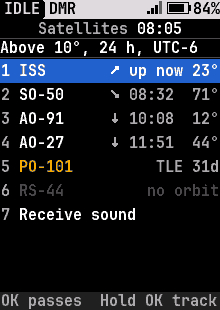
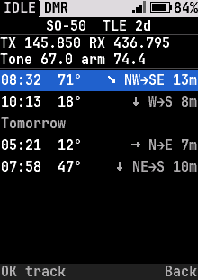

<!-- SPDX-License-Identifier: MIT -->
<!-- Copyright (c) 2026 The RadioFoundry Authors -->

# Satellites

In a build with satellite tracking (`CONFIG_SAT`, off in the standard images), the radio predicts when the amateur
satellites you store pass over you. It works the passes out itself, from each satellite's orbital elements (a TLE) and
your position and time. Which radios can store satellites: [Feature matrix](../feature-matrix.md).

Status: the satellite list, the pass list and the Tracking screen with Doppler correction are built and tested in the
simulator. The newest options (the frequency you type and **OK** to swap to it, UTC or local times, the time zone from
the phone) are less tested on a radio than the rest. A quick start is in the [README](../../README.md#satellite-tracking).




## What the radio needs

| Need | Where it comes from |
|---|---|
| The time | A GPS fix (or a phone or computer sending NMEA over the cable). Until the first fix the list says "Waiting for the time" |
| Your position | The GPS fix, the computer's, or the fixed position in **Tools > APRS** |
| The satellites | Loaded over the cable, below. Each needs a TLE: element sets go stale, so load fresh ones every week or two |

## Keeping the orbit data current

Plug in the programming cable (the radio on, Home showing) and run one command on your computer:

```
rfoundry_debug.py sat update
```

It downloads the current amateur-satellite element sets (CelesTrak's amateur group), and for each satellite stored on
the radio with a newer set, loads it, keeping that satellite's frequencies, tones and arming. One line per satellite
says what it did: updated, already current, or not in the download. Nothing needs arming on the radio, and nothing is
sent that isn't a satellite record.

```
rfoundry_debug.py sat update --dry-run          say what would change, change nothing
rfoundry_debug.py sat update --add 44909        also store a satellite that isn't on the radio yet
rfoundry_debug.py sat update --file amateur.txt use a file you saved (CelesTrak or AMSAT), with no internet connection
```

A satellite added with `--add` that the radio knows (the ISS, SO-50, AO-91) gets its frequencies and tones. Any other is
stored by name with no frequencies, so it has passes but no Doppler yet. A low-orbit FM satellite's elements are good
for about one to two weeks: update before a trip.

## Loading satellites by hand

`tools/rfoundry_debug.py` can also load one satellite's TLE and store it with frequencies you give:

```
rfoundry_debug.py sat load iss.tle                  the TLE: a file with its two lines, or the two lines
rfoundry_debug.py sat save                          stored with the radio's own profile (ISS, SO-50, AO-91)
rfoundry_debug.py sat save 435.250 145.960 67.0 AO-91   or with the uplink and downlink (MHz), tone (Hz), name
rfoundry_debug.py sat list                          what is stored, and how old each TLE is
rfoundry_debug.py sat delete 43017                  remove one by its catalog number
```

The TLEs come from the usual sources (CelesTrak, AMSAT): the two lines that follow a satellite's name. The radio checks
each line's check digit and refuses a TLE with a typo.

## Tools > Satellites

**OK 6 0** (Tools, 0). Each stored satellite with its next pass that peaks at least as high as **Lowest pass**:

| Row shows | Means |
|---|---|
| ↘ 08:32 71° | It rises at 08:32 local time and peaks 71° up. The arrow is its way across the sky: from where it rises toward where it sets, north up |
| up now 23° (green) | It is overhead now, 23° up |
| … | Being worked out |
| no pass | None high enough in the next 24 hours |
| TLE 31d (amber) | Its TLE is a month old: load a fresh one |
| no orbit (dimmed) | Stored without a TLE |

The line under the title says the lowest pass, the 24 hours and the time zone the times are in.

**OK** on a satellite lists its passes over the next 24 hours: the rise time, how high it gets, its way across the sky
(arrow and directions, "NW→SE") and how many minutes it is up. Above the list are its frequencies and tones, and the
title says how old its TLE is. Passes of the next day follow a "Tomorrow" line.

**OK** on a pass tracks it (or hold **OK** on a satellite in the list to track its next pass). The screen has a sky plot
with north up and the pass's whole path, the satellite as a dot (green above the horizon), and beside it: the elevation,
the azimuth, the time left to the set (**LOS**) or to the rise (**AOS**), your grid locator (for the contact that asks
"what's your grid?"), the range, and **always the frequencies the radio is on**, **RX** and **TX**: whatever it was playing
until you tune it, then the satellite's. The dot, the azimuth and the range appear only while the satellite is above your
horizon; before the rise (and after the set) the plot shows the path alone and the screen says "Below horizon" just
before the rise.

Keys on the Tracking screen:

| Key | Does |
|---|---|
| **#** | Tunes the receiver to the satellite's downlink, corrected for Doppler. The first press puts the radio in the VFO with the satellite's settings: FM, 25 kHz, no receive tone, and its uplink as the transmit frequency (a split, with its tone). Press **#** again to retune as the Doppler moves (it keeps your dial setting); hold **#** to clear the dial setting and retune to the computed frequency alone. The receive line shows how far the downlink is from the satellite's own ("+3.4k") and turns the warning color when the radio is 1.5 kHz or more behind. Back puts the channel you were on back |
| **\*** | The radio follows the Doppler by itself: **AUTO** shows, and the receiver is retuned whenever it is 1.5 kHz or more off, at most every 5 seconds. It tunes to the shift for the rise about two minutes before the satellite comes up, keeps your dial setting, and never retunes while you transmit. The first press tunes the receiver too, if **#** has not. **\*** again stops it. Back ends it. This screen uses **\*** itself, not the quick menu |
| **OK** | Swaps between the satellite's own downlink and the one you saved for it, for example for a special event or a beacon on another frequency, so you can go back and forth during a pass without typing it again. The "OK" line shows the frequency it will swap to. With none saved, **OK** opens the **Frequency** screen to type one |
| **1** | Opens the **Frequency** screen to type a downlink of your own or change the saved one: type the frequency in MHz as on the VFO (**Back** takes a digit back), **OK** saves it for this satellite and listens on it. The Doppler shift, the dial and **\*** work on it as on the satellite's own. It is **receive only**: the TX line says "RX only" and the radio refuses PTT, since a typed frequency is a downlink. Saved in the radio's settings, so it is there at the next pass and after a power cycle; one frequency is kept, for the satellite you typed it for |
| **0** | Opens the squelch and holds it open, to listen to the whole pass. **0** again, or Back, closes it. FM only |
| The dial (or **Up** and **Down**) | Nudges the downlink up or down by 1 kHz a click, up to 10 kHz, for a satellite whose own transmitter is slightly off. The nudge is added to every retune, manual or automatic |

Opening the screen changes nothing: the radio keeps what it was playing until you press **#** or **\***. A retune takes
about 10 ms, which is a click, and following retunes about once a minute on 70 cm, less often on 2 m. The transmit
frequency is the satellite's own uplink: the radio does not shift it. A satellite with no uplink in its profile, and a
frequency you type, are receive only.

## Updating the element sets from a phone

The element sets go stale within a week or two. A browser page loads fresh ones over the programming cable, from a phone
or a computer, and also sets the radio's clock and shows its diagnostics:
<https://mabecr.github.io/sat-tle-tools/> (Chrome or Edge; on Android the cable goes on an OTG adapter). It uses the same
rules as `rfoundry_debug.py sat update` and never changes what a satellite is set up to do. How it works:
[the page's notes](../dev/sat-tle-web-tool.md).

## Settings

**Settings > Location** ([Settings](17-settings.md)):

- **Time zone**: your offset from UTC, for the times on these screens. There is no daylight saving rule: change it when
  the clocks change, or let the [TLE page](../dev/sat-tle-web-tool.md) set it: when it sets the clock from your phone it
  sends the phone's own offset (daylight saving included) too.
- **Pass times in UTC**: on, the times on these screens are UTC and the title says so; off, they are in your Time zone.
  The Time zone setting is kept either way.
- **Set time**: the date and time in UTC, for when there's no GPS fix. Up and Down (or the knob) change the field,
  digits type it, **#** moves to the next field, **OK** sets it. Pick the next minute from a phone's clock, and press OK
  as it reaches :00. The radio keeps it while off (on a radio with a battery-backed clock), so you set it once; a GPS fix
  corrects it whenever there is one. The "Local" line shows the same time with your Time zone.
- **Lowest pass**: passes that peak lower are left off (10° at first). A handheld antenna usually needs 20° or more.
